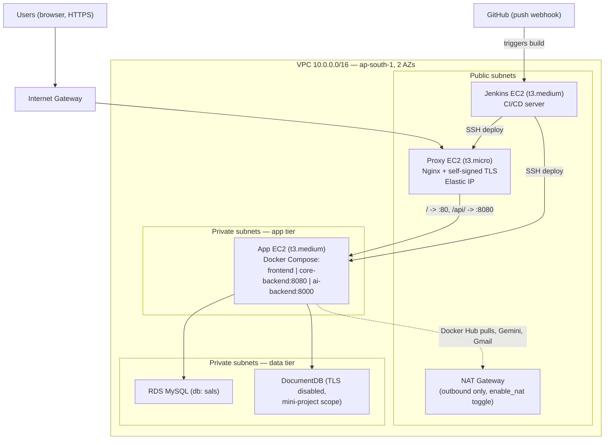

# SmartPathMaker — AWS Deployment

Automated CI/CD: Terraform provisions AWS infrastructure, Jenkins builds and deploys the application on every commit to `master`.

## 1. Architecture



This replaces the earlier draft in `raw_images/image.png`, which showed three separate per-service EC2s with no reverse proxy — superseded by the single app EC2 (3 containers) + dedicated proxy EC2 design above.

**Request flow:** browser → proxy EC2 → `/` to the frontend container, `/api/*` to Spring, `/healthz` to Spring's actuator health. Spring calls FastAPI by container name over the Compose network, and reaches RDS/DocumentDB over the VPC. The frontend container never calls a backend directly — only the browser does.

## 2. Terraform

Layout: `terraform/modules/{networking,security,database,compute}`, `terraform/envs/dev`.

```powershell
cd terraform/envs/dev
Copy-Item terraform.tfvars.example terraform.tfvars
# edit terraform.tfvars: owner_ip_cidr, ssh_public_key, github_webhook_cidrs

terraform init
terraform fmt -check -recursive ..
terraform validate
terraform plan
terraform apply   # costs money — review the plan first
```

Module order (each validated independently before being wired together in `envs/dev`): `networking` → `security` → `database` → `compute`.

- `enable_nat` (default `true`) gates the NAT gateway. Set `terraform apply -var enable_nat=false` to tear it down when the infra is idle, and back to `true` before the next deploy — the app-private route table simply gains/loses its `0.0.0.0/0` route.
- State is local (`terraform.tfstate`, gitignored) — fine for a solo mini-project. **The state file contains the generated RDS/DocumentDB passwords in plaintext** — never commit it, never paste its contents anywhere.
- After `apply`, note the outputs: `proxy_public_ip`, `app_private_ip`, `jenkins_public_ip`, `mysql_endpoint`, `docdb_endpoint`. You'll need the first three as Jenkins job parameters.

## 3. One-time secrets

Terraform writes the RDS/DocumentDB-derived SSM parameters itself (`SPRING_DATASOURCE_*`, `SPRING_DATA_MONGODB_URI`, `VITE_FE_URL`). Four secrets are **not** generated by Terraform and must be entered once, by hand, after `apply`:

```powershell
$cmk = terraform -chdir=terraform/envs/dev output -raw ssm_kms_key_id  # or read it from module.compute output

aws ssm put-parameter --region ap-south-1 --type SecureString --key-id $cmk `
  --name /sals/prod/GEMINI_API_KEY --value "<new rotated key>"
aws ssm put-parameter --region ap-south-1 --type SecureString --key-id $cmk `
  --name /sals/prod/APP_JWT_SECRET --value "<long random string, 32+ chars>"
aws ssm put-parameter --region ap-south-1 --type SecureString --key-id $cmk `
  --name /sals/prod/SPRING_MAIL_USERNAME --value "<gmail address>"
aws ssm put-parameter --region ap-south-1 --type SecureString --key-id $cmk `
  --name /sals/prod/SPRING_MAIL_PASSWORD --value "<gmail app password, no spaces>"
```

Only the app EC2's IAM role can read `/sals/prod/*` (enforced by its instance profile policy — see `terraform/modules/compute/main.tf`).

## 4. Jenkins setup

1. Open `http://<jenkins_public_ip>:8080`, unlock with the initial admin password (`/var/lib/jenkins/secrets/initialAdminPassword` on the Jenkins EC2), install suggested plugins + **GitHub plugin** + **SSH Agent plugin**.
2. Add credentials (Jenkins → Manage Jenkins → Credentials):
   - `dockerhub-creds` — Username/password (Docker Hub access token as the password).
   - `deploy-ssh-key` — SSH Username with private key, username `ec2-user`, private key = the key paired with `ssh_public_key` in `terraform.tfvars`.
3. Create a Pipeline job pointing at this repo's `Jenkinsfile`, with parameters `APP_HOST` = `app_private_ip` and `PROXY_HOST` = `proxy_public_ip` from the Terraform outputs.
4. GitHub repo → Settings → Webhooks → add `http://<jenkins_public_ip>:8080/github-webhook/`, content type `application/json`, event: `push`. If delivery is unreliable (e.g. Jenkins EC2 restarted with a new IP because it has no Elastic IP), switch the `triggers` block in the `Jenkinsfile` from `githubPush()` to `pollSCM('H/5 * * * *')`.
5. Push to `master` — the pipeline should run Checkout → Validate → Build → Test → Deploy → Verify end to end. This is the project's actual success criterion.

## 5. Day-2 operations

- **Rollback**: automatic — if the Verify stage's health check fails, the pipeline's `post { failure { ... } }` block redeploys the previous successful build's image tag to both EC2s.
- **Cost control**: `terraform apply -var enable_nat=false` when idle; `terraform destroy` to tear everything down between work sessions (re-`apply` + re-enter the 4 manual secrets + re-run a Jenkins build to restore).
- **Manual redeploy**: re-run the Jenkins job, or SSH in directly and `docker compose pull && docker compose up -d` with the right `IMAGE_TAG`.

## 6. Troubleshooting

- **CORS / login 403**: `SecurityConfig.java`'s CORS bean reads `VITE_FE_URL` — confirm the SSM parameter matches the proxy's actual origin (`https://<proxy_public_ip>` or your domain if you add one later).
- **`/healthz` not `UP`**: check `docker compose ps` on the app EC2 for container health, then `docker compose logs core-backend`. Spring's start period is ~90s; FastAPI preloads known_faces at startup and can take longer on first boot.
- **SSH from Jenkins fails**: confirm `deploy-ssh-key`'s public half matches `terraform.tfvars`' `ssh_public_key`, and that the app-sg/proxy-sg rules allowing 22 from jenkins-sg were actually applied (`terraform plan` should show no pending changes).
- **Terraform can't reach `registry.terraform.io` from your laptop**: this happened during development on a corporate network where only certain tools' outbound DNS worked. Terraform validate/init only needs to run successfully once, on whatever network lets it through — the Jenkins EC2 itself has normal internet access via the IGW/NAT and runs its own `terraform validate` inside the pipeline's Validate stage without issue.

## 7. Data migration (TiDB/Atlas → RDS/DocumentDB)

Run from the app EC2 (it's the one place with network access to both the old and new databases) via SSH, using client containers so nothing extra is installed on the host:

1. `docker run --rm mysql:8.4 mysqldump -h <tidb-host> -u <user> -p sals > sals.sql`, create the schema on RDS if needed, `mysql -h <rds-endpoint> -u sals_app -p sals < sals.sql`. Point `/sals/prod/SPRING_DATASOURCE_URL` at RDS if it isn't already (Terraform sets this automatically).
2. `docker run --rm mongo:7 mongodump --uri="<atlas-uri>" --out=/dump`, then `mongorestore --uri="<docdb-uri>" /dump` (DocumentDB, TLS disabled, `authSource=admin`).
3. Smoke test both, then cut over `VITE_FE_URL`/DNS last so the old origin and new origin don't both serve traffic at once. Keep the old sources read-only for a rollback window before decommissioning them.
